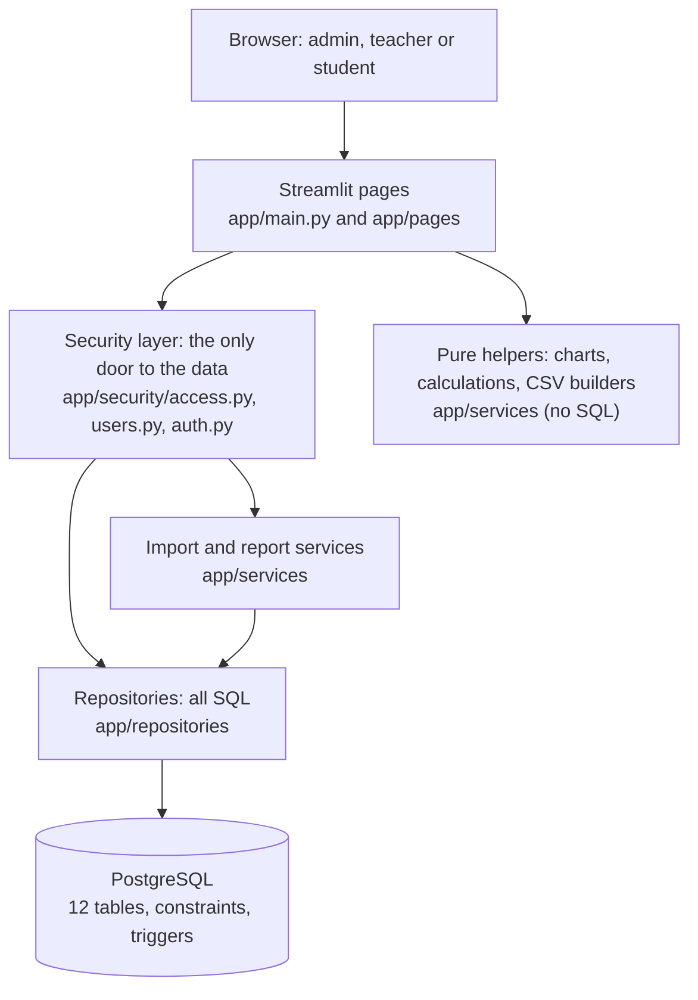
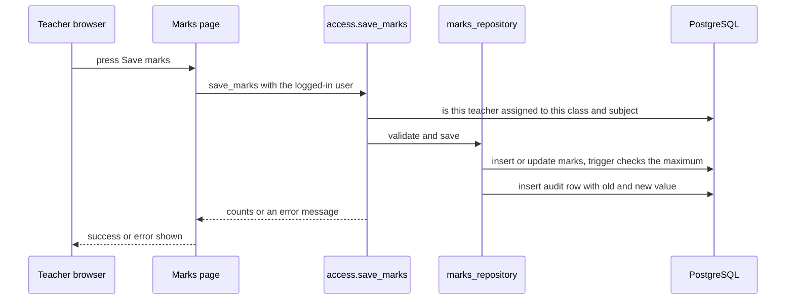

# Architecture

The application is a small layered design. Each layer has one job, and the security checks live in one place.

## Layers

| Layer | Folder | Does | Never does |
|---|---|---|---|
| Pages | `app/main.py`, `app/pages` | Show forms, tables and charts; call the security layer | Talk to the database, contain business rules |
| Security layer | `app/security` | Check who the user is and what they may touch, then call repositories; write audit rows | Build screens |
| Services | `app/services` | CSV validation, calculations, reports, charts | Decide permissions |
| Repositories | `app/repositories` | Run SQL with parameters, validate input before saving | Know about users or screens |
| Database | `app/db/schema.sql` | Last line of defence: unique keys, checks, foreign keys, triggers | Business workflows |

A test scans every page and fails if a page imports a repository or an importer directly, so the UI can never bypass the security layer.

## One request: a teacher saves marks

If any value is wrong, nothing is saved: everything is validated first and runs in one transaction.

## Roles and authorization

* The logged-in user is re-read from the database on **every page load**, so a disabled account or a changed role works immediately.
* **Admin**: no limit. **Teacher**: only the (class, subject) pairs in `teacher_assignments`, looked up fresh on every call, also for CSV imports and exports.
  **Student**: only their own records; the student functions (`my_profile`, `my_attendance`, `my_marks`) have no student-id parameter at all, so changing an ID or a URL cannot show another student's data.
* A test checks that every function in `access.py` takes the user as its second parameter.

## Design decisions

* **Validate twice**: friendly checks in Python (clear messages), and database constraints/triggers as the last line of defence.
* **All-or-nothing CSV import**: any bad row means nothing is imported and every problem is listed, so no record is silently lost.
* **Audit log is append-only** (database trigger): who changed what, with old and new values. The limited database role cannot edit it either.
* **One definition of each rule**: attendance % and marks % are calculated in `app/validation.py` and reused everywhere (screens, reports, dashboard).
* **Safe errors**: users see a short message and a reference number; details go to `logs/app.log`.
* **Secrets in environment variables** (`.env`, ignored by git); no passwords in code.
