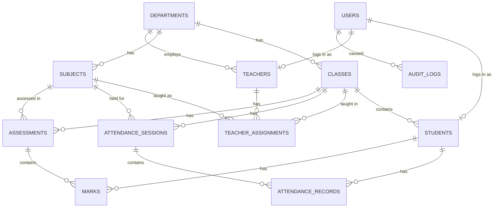

# Database

PostgreSQL. The whole schema is in `app/db/schema.sql`.

## Relationships



In words: a **department** has classes, subjects and teachers. A **class** (one semester) has students. A **subject** belongs to a
department and a semester, so the subjects of a class are the subjects with the same department and semester.
A **teacher assignment** says "this teacher teaches this subject to this class" (many-to-many). An **attendance session** is one
lecture (class, subject, date, lecture number) and holds one **attendance record** per student. An **assessment** (for example
"Internal-1", with a maximum) holds one **mark** per student. A **user** is a login; it is linked to exactly one student or
one teacher (admins have no profile). Every important change adds a row to **audit_logs**.

## Tables

| Table | Purpose | Key rules |
|---|---|---|
| `users` | Logins | unique username (case-insensitive), role admin/teacher/student, bcrypt hash, failed-attempt counter and lock time |
| `departments` | Departments | unique name |
| `classes` | A class in a semester | unique (department, name), semester 1..10 |
| `subjects` | Subjects | unique code, semester 1..10 |
| `students` | Student records | unique `student_code`, non-empty name, status active/inactive, optional unique link to a user |
| `teachers` | Teacher profiles | one per user |
| `teacher_assignments` | Teacher - class - subject | unique triple |
| `attendance_sessions` | One lecture | unique (class, subject, date, lecture number), created_by |
| `attendance_records` | Present/absent per student | unique (session, student), status present/absent |
| `assessments` | A test with a maximum | unique (class, subject, name), maximum > 0 |
| `marks` | Obtained marks | unique (assessment, student), >= 0, updated_by, timestamps |
| `audit_logs` | Change history | append-only |

## Constraints and triggers

* `trg_marks_within_max`: obtained marks can never exceed the assessment maximum (insert or update).
* `trg_assessment_max_check`: the maximum cannot be lowered below marks that already exist.
* `trg_students_updated`, `trg_marks_updated`: keep `updated_at` current.
* `trg_audit_logs_append_only`: rows of `audit_logs` cannot be updated or deleted.
* Indexes on the columns used for filtering: students by class, attendance records by student, sessions by (class, subject, date), marks by student, assessments by (class, subject), audit log by (table, record).
* Foreign keys everywhere; deleting a session removes its attendance records.

## Creating and upgrading the schema

`schema.sql` is **idempotent** (`IF NOT EXISTS`, `CREATE OR REPLACE`, `DROP TRIGGER IF EXISTS`), so the same command creates a new
database and upgrades an old one without losing data:

```bat
python -m app.db.init_db
```

Run it after you download a new version of the project. There is no versioned migration tool yet (listed as a future enhancement).
Run it as the `postgres` owner, not as the limited `student_app` role.
